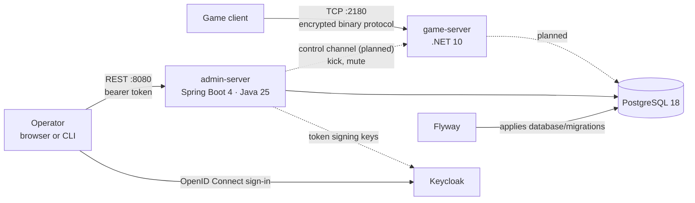

# OpenTaan

[](https://github.com/thedoctor2001/opentaan-server/actions/workflows/game-server.yml)
[](https://github.com/thedoctor2001/opentaan-server/actions/workflows/admin-server.yml)
[](https://github.com/thedoctor2001/opentaan-server/actions/workflows/stack.yml)

An open server for the TAAN online game client: a .NET game server that speaks
the client's binary TCP protocol, and a Spring Boot back office that lets
operators look after accounts and the in-game economy.

Two problems shape the design:

- **The protocol has no specification.** It has 343 packet types, and a wrong byte
  does not produce an error: the client hangs or quits. So correctness is defined
  as *byte-for-byte agreement* with reference sessions captured from the client,
  not by reading code. That reference data is derived from the client's own
  files, so it is supplied locally rather than committed.
- **The back office moves value.** Economy adjustments change what players own.
  It is built with the controls a bank would expect: an API contract written
  before the code, a permission check on every endpoint, four-eyes approval and
  idempotency keys on every gold adjustment, and an append-only, hash-chained
  audit trail of every operator action.

## Architecture



| Path | What it is |
|---|---|
| [`game-server/`](game-server) | .NET 10 solution: transport, host, architecture tests |
| [`admin-server/`](admin-server) | Spring Boot 4 back office, generated from the OpenAPI contract |
| [`contracts/`](contracts) | What every implementation agrees on, starting with the admin API |
| [`database/`](database) | Flyway migrations; the only place tables are defined |
| [`deploy/`](deploy) | Keycloak realm and the script that adds operators |
| [`secrets/`](secrets) | Local secret files, mounted as Docker secrets; never committed |
| [`docker-compose.yml`](docker-compose.yml) | The whole stack on one machine |

## Run it

You need Docker. Create the two local secrets, start everything and add yourself
as an operator:

```sh
openssl rand -base64 32 | tr -d '\n' > secrets/db_password
openssl rand -base64 32 | tr -d '\n' > secrets/keycloak_admin_password
docker compose up --build -d
deploy/keycloak/add-operator.sh your-name admin
```

Then sign in and call the API:

```sh
TOKEN=$(curl -s http://localhost:8081/realms/opentaan/protocol/openid-connect/token \
  -d grant_type=password -d client_id=opentaan-cli -d username=your-name \
  --data-urlencode "password=<your password>" | jq -r .access_token)

curl -H "Authorization: Bearer $TOKEN" http://localhost:8080/api/accounts/1
```

| URL | What is there |
|---|---|
| http://localhost:8080/swagger-ui.html | The admin API contract, browsable |
| http://localhost:8080/actuator/health | Admin server health |
| http://localhost:8081 | Keycloak (user `admin`, password in `secrets/keycloak_admin_password`) |
| `localhost:2180` | Game server (TCP) |

The command-line client (`opentaan-cli`) uses the password grant and exists for
local development only; the browser client uses authorization code with PKCE.

## How correctness is checked

| Check | Where | What it catches |
|---|---|---|
| Contract-first API | `admin-server` build | Code that drifts from `contracts/openapi/admin-api.yaml`: controllers implement generated interfaces |
| Permission tests | `AccountsControllerTest`, `AuditControllerTest`, `OperatorRolesTest` | 401 and 403 paths, role-to-permission mapping, secrets in responses |
| Architecture rules | ArchUnit, NetArchTest | An endpoint without a permission check, a controller reaching a repository, transport code depending on game code |
| Real database | Testcontainers | Mappings that do not match the schema the migrations produce; a retry racing the original request |
| Database constraints | `database/migrations` | A code path that lets an operator approve their own adjustment, a zero amount, a rejection with no reason |
| Audit trail | `AuditTrailIT`, `AuditChainTest` | An audit entry changed or removed, even with the database trigger switched off; concurrent writers forking the chain; the Java verifier and the database disagreeing on a hash |
| Whole stack | `.github/workflows/stack.yml` | Wiring, on every pull request: operators sign in through Keycloak, read an account, take a large adjustment through four-eyes approval into the outbox, and an auditor checks the trail those actions left |

## Develop

| | Build and test | Needs |
|---|---|---|
| Game server | `cd game-server && dotnet test --solution OpenTaan.GameServer.slnx` | .NET SDK 10.0.201+ |
| Admin server | `cd admin-server && ./mvnw verify` | JDK 25 (integration tests also need Docker) |

Each service has its own README with the details.

## Key decisions

Each is written up with its alternatives and consequences in
[`docs/adr`](docs/adr). What the system protects, and what is still open, is in
the [threat model](docs/security/threat-model.md); how each property is
checked, with what those checks caught, is in
[How correctness is checked](docs/correctness.md).

- **Two runtimes on purpose.** The game server needs low-level control over bytes
  and threads, so it is .NET. The back office is where enterprise conventions
  matter most, so it is Spring Boot. They share contracts, not code.
- **The schema belongs to neither service.** Both use one database, so Flyway owns
  the tables and each service only checks that its mappings match.
- **Roles live in the identity provider; permissions live in code.** Keycloak says
  who an operator is and which roles they hold; which permissions a role grants is
  a reviewed change in `application.yml`.
- **Secrets are files.** Every password is a Docker secret read from `secrets/`, so
  none is written in the compose file, baked into an image or visible in
  `docker inspect`.

## Status

| Area | State |
|---|---|
| Game server: host, listener, architecture tests | Done |
| Game protocol: reference sessions, supplied locally, not committed | In progress |
| Game server: transport (framing and encryption), verified byte for byte | Next |
| Game server: packet codecs, persistence, game logic | Planned |
| Admin server: account lookup, contract-first API, permission model | Done |
| Admin server: economy adjustments with four-eyes approval and idempotency keys | Done |
| Admin server: append-only, hash-chained audit trail | Done |
| Delivering approved adjustments to the game server | Planned: needs game state in the game server |
| Local stack with Keycloak, tested end to end in CI | Done |

The full plan, what is done and what comes next: [docs/roadmap.md](docs/roadmap.md).

## Notice

This repository contains no files from the game client: no executables, assets or
data files. Running the game server against a client requires your own copy of
it. OpenTaan is an independent project and is not affiliated with or endorsed by
the game's publisher.

Licensed under the [GNU General Public License v3.0](LICENSE).
