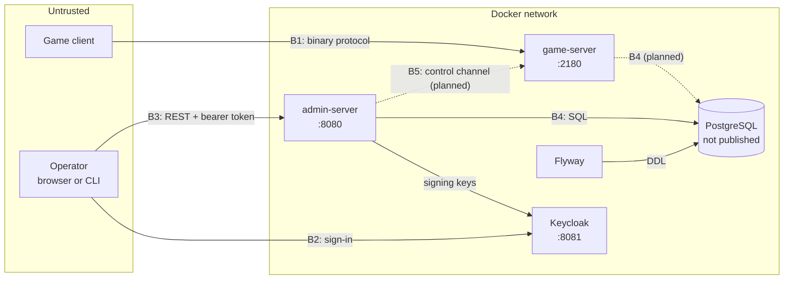

# Threat model

What OpenTaan protects, from whom, and how. Each threat names the control that
addresses it and where that control is tested, or says plainly that it is
open. Last reviewed 2026-11-02. Review again when a new entry point is added
(the game server transport, the control channel, the operator portal) or
before any deployment beyond a local machine.

## Scope

The stack in `docker-compose.yml`: the admin server, Keycloak, PostgreSQL,
Flyway and the game server, plus the CI that builds them. The game server
serves the login, character, channel and lobby stages; its threats are listed
with the controls in place and those planned for the stages still to come. A production
deployment (TLS termination, networks, backups, monitoring) is not designed
yet and is out of scope, except where the local setup would be unsafe to copy.

## Assets

| Asset | Where it lives | Why it matters |
|---|---|---|
| In-game currency | `economy_adjustments`, later the game server's state | Changing it creates value; the economy depends on it being scarce |
| Players' personal data | `accounts.email`; `accounts.hashed_password` | Privacy obligations; password hashes enable offline cracking |
| The audit trail | `audit_entries` | The evidence of who did what; worthless if it can be edited |
| Operator identities | Keycloak realm `opentaan` | An operator's token can do whatever their roles allow |
| Secrets | `secrets/` files, mounted as Docker secrets | Database and Keycloak admin passwords |
| Approved adjustments in flight | `outbox_events` | Losing one loses a player's money; sending one twice creates it |

## Actors

| Actor | Trust |
|---|---|
| Operator | Authenticated; limited to the permissions of their roles; may make mistakes or act dishonestly alone |
| Two operators together | Can pass dual control; the system cannot stop collusion, only record it |
| Auditor | Authenticated; reads the audit trail and the ledger; changes nothing |
| Player, through the game client | Untrusted; anything the client sends may be crafted |
| Anyone on the network | Untrusted; can connect to every published port |
| Whoever administers the database | Trusted with the data, but the audit trail must show what they changed |
| Third-party code | Dependencies, base images and CI actions run with the privileges of what includes them |

## Trust boundaries

- **B1:** the internet-facing game port. Everything the client sends is input
  to validate.
- **B2, B3:** operators sign in to Keycloak and present its tokens to the admin
  server.
- **B4:** the services' access to the database. Today both use the database
  owner role (see T-D1).
- **B5:** the admin server's future commands to the game server.

## Threats and controls

Status: **Mitigated** (control in place and tested), **Partly** (control in
place with a known gap), **Open** (no control yet), **Planned** (the component
does not exist yet; the control comes with it).

### Admin API and operators

| Id | Threat | Control | Status |
|---|---|---|---|
| T-A1 | A request without a valid token reaches an operation | Every `/api` route requires a bearer token signed by the realm's keys, from the expected issuer; tokens live five minutes | Mitigated: `AccountsControllerTest`, stack job (401) |
| T-A2 | An operator calls an operation their job does not allow | Each operation requires exactly one permission; roles map to permissions in `application.yml`; unknown permissions stop startup; an architecture test fails the build if an endpoint has no check | Mitigated: `ArchitectureTest`, `OperatorRolesTest`, controller tests (403) |
| T-A3 | A token issued to another client of the realm is accepted | Tokens are not checked for audience; the realm has only operator clients | Open, low: check `aud` once the portal client exists |
| T-A4 | Operator passwords are guessed | Keycloak brute-force protection (5 failures), no self-registration, no password reset | Partly: no MFA yet |
| T-A5 | The password-grant client is used outside development | `opentaan-cli` is labelled local-only; the browser client uses authorization code with PKCE | Open: disable the client in any shared realm |
| T-A6 | One operator moves a large amount alone | Dual control above the threshold, in the entity and as the `decider_is_not_requester` constraint | Mitigated: `EconomyAdjustmentTest`, `EconomyAdjustmentServiceIT`, stack job |
| T-A7 | Two operators collude | Out of the system's reach; both are recorded in the audit trail | Accepted: detect through audit review |
| T-A8 | A retry or double-click credits twice | Idempotency key unique per operator, with a hash of the request; concurrent duplicates resolved by the unique constraint | Mitigated: race test in `EconomyAdjustmentServiceIT`, stack job |
| T-A9 | Two operators decide the same adjustment at once | Optimistic locking; the second decision gets 409 | Mitigated |
| T-A10 | A player's personal data is read without trace | `accounts:read` required; every read is written to the audit trail in the same transaction; the password hash column is not mapped at all | Mitigated: `AccountQueryServiceIT`, `AccountsControllerTest` |
| T-A11 | Errors leak internals | Problem details with fixed titles; no stack traces in responses | Mitigated |
| T-A12 | The operator API is flooded | Only authenticated callers reach it; no rate limiting | Open, low while operators are few and internal |

### Audit trail and records

| Id | Threat | Control | Status |
|---|---|---|---|
| T-R1 | An operator denies an action | Every change and every account read is recorded in the action's transaction, with the actor taken from the token | Mitigated: `EconomyAdjustmentServiceIT`, `AccountQueryServiceIT`, stack job |
| T-R2 | A refused attempt, such as approving one's own adjustment, leaves no record | Refused actions roll back with their entry | Open: record refusals in a separate transaction |
| T-R3 | An entry is changed or deleted through SQL | Trigger refuses `UPDATE`, `DELETE` and `TRUNCATE` for every role | Mitigated: `AuditTrailIT`, stack job |
| T-R4 | The table owner switches the trigger off and edits an entry | Hash chain; `GET /api/audit/verification` finds the entry | Mitigated: `AuditTrailIT` |
| T-R5 | The table owner edits an entry and rebuilds every later hash | The chain verifies again; only a copy of an earlier chain head kept elsewhere reveals it | Partly: auditors can record `lastHash` by hand; automatic anchoring is open |
| T-R6 | The newest entries are deleted | The chain stays valid without them | Partly: same control as T-R5 |

### Database and secrets

| Id | Threat | Control | Status |
|---|---|---|---|
| T-D1 | A flaw in a service is used to change the schema, switch triggers off or read everything | The services connect as the database owner, which can do all three | **Open, highest priority:** a login role per service with only the table privileges it needs |
| T-D2 | The database is reached from outside | Its port is not published; only containers on the compose network reach it | Mitigated locally |
| T-D3 | Passwords leak through the repository, an image or `docker inspect` | Secrets are files, git-ignored, mounted as Docker secrets and read inside each container; CI generates its own | Mitigated: see [ADR 0009](../adr/0009-secrets-are-files.md) |
| T-D4 | A leaked password stays valid | Rotation is a manual procedure in `secrets/README.md` | Partly |
| T-D5 | A schema change bypasses review | Only Flyway runs DDL, from reviewed migration files; the admin server refuses to start on a mismatch | Mitigated |

### Game server

| Id | Threat | Control | Status |
|---|---|---|---|
| T-G1 | Oversized or malformed frames exhaust memory or crash the server | Hard size limits before allocating; parsers that reject input instead of trusting lengths; transport tests with hostile input | Mitigated for the login and character stages: the transport and the codecs refuse impossible lengths and counts before allocating (`FrameReaderTests`, `PacketReaderTests`); each connection reads into one fixed buffer the size of the receive window, and a frame that cannot be read or a body that cannot be decoded closes the connection at once (`SessionTests`). Each new codec brings its own hostile tests. Data envelopes are unwrapped against a size limit checked before allocating, decompression stops at the declared size so a small envelope cannot expand without bound, and data trees nested past 32 levels are refused (`DataEnvelopeTests`, `DataNodeTests`) |
| T-G2 | Connection floods, or clients that hold connections and memory without using them | Limits per address and overall; an idle timeout; a bounded send queue and a send timeout, so a client that stops reading costs only its own connection | Partly: all four (`ConnectionLimiterTests`, `GameListenerTests`, `SessionTests`); no limit on packets per second yet |
| T-G3 | A crafted client gives itself items or currency, or acts on characters that are not its own | The server owns all game state; client input states intent and is checked against it; currency changes only through the server's own rules and approved adjustments. A character is selected or deleted only by its own account; a new character's starting values come from configuration, never the request, and it keeps only the appearance parts the client's creator offers | Partly: ownership and creation (`CharacterFlowTests`, `InMemoryCharacterStoreTests`); appearance item ids are not checked against the client's item data yet, and the rest comes with game logic |
| T-G4 | Traffic between client and server is read | The client fixes the protocol, including its encryption, and the server cannot change it; nothing is sent to the client that it may not see | Accepted: a property of the client |
| T-G5 | Game account passwords are cracked from a database copy | Hashing is done by the game server; the admin server never reads the column | Planned with persistence |
| T-G6 | A handshake switches encryption off, or one client predicts another's seeds | Handshake values that derive the plaintext seed cannot be constructed; generation re-draws them and fails loudly rather than fall back; values come from a cryptographic generator | Mitigated: `HandshakeKeysTests` |
| T-G7 | Credentials from login packets reach logs | Password hashes are held in a type that prints as `***`; the handshake prints its shift, never its seeds | Mitigated: `SecretTests`, `HandshakeCodecTests`; email addresses are not logged either |
| T-G8 | Game account passwords are guessed, or any account is logged in to | Outside Development an account must be created before it logs in, with the password it was created with, compared in constant time; the server refuses to start with that switched off; a throttle per account and per address | Partly: registration and passwords enforced (`LoginFlowTests`), and the start-up check; no throttle yet (planned with persistence) |
| T-G9 | A player gets the game master console | Only configuration names game master accounts, never a packet; the flag opens the client's console and nothing more, and every game master request is checked again by the server | Partly: the flag comes only from configuration (`LoginFlowTests`); no game master requests are handled yet |
| T-G10 | One account is played twice at once, by two clients or by one client naming it in both of its slots: each copy spends the same items, messages reach the wrong copy, and a match pays twice | An account is live on one connection at a time. A login naming an account twice, or an account another connection holds, is refused; the connection already playing is never closed for it. The check follows the password check, so it cannot tell anyone whether an account is online, and it is one step with the claim, so of two logins at once exactly one succeeds. An account is freed when its connection closes, including by the idle timeout; a match will pay each character once whatever seats it holds | Partly: login refuses both (`LoginFlowTests`, `LoggedInAccountsTests`); the payout rule comes with matches |
| T-G11 | A crafted request makes the server echo an account slot the client then writes through: the client stores the characters a creation or deletion answer carries at the slot it names, without checking it, so an echoed slot of the attacker's choosing is a write into the client's memory at an offset they pick | Only a slot the connection holds is ever echoed; any other is answered for slot 0, and the request still gets an answer, since the client waits for it with no time limit | Mitigated: `CharacterFlowTests` (slots 1, 7 and 255 on a one-account connection, for creation and deletion); the cash answer, whose slot is a full 32-bit value, the same way (`ChannelAndLobbyFlowTests`) |
| T-G12 | Character names are listed by asking about each one: the name check and the in-game lookup both say whether a name is taken | A name no client could create is answered without a lookup; a throttle per connection, and collapsing the copies of one request the client sends on each of its connections, come with the second connection of the game stage | Open: no throttle yet |
| T-G13 | Pictures the client sends of its characters fill the disk, or are written outside their folder | Kept only when a folder is configured; named by the character's id alone, so nothing the client sends reaches the path; only for a character the connection has selected, one file per character, each replacing the last; each bounded by the frame size | Mitigated: `ChannelAndLobbyFlowTests`; no limit on how often a client sends one, which waits for the per-connection packet limit (T-G2) |

### Supply chain and CI

| Id | Threat | Control | Status |
|---|---|---|---|
| T-S1 | A vulnerable dependency or base image ships | Versions are pinned; Dependabot proposes updates weekly for Maven, NuGet, base images, compose images and actions; the `security` workflow scans both images on every change and weekly, fails on fixable HIGH or CRITICAL findings, and keeps an SBOM of each | Partly: no static analysis of our own code yet (CodeQL) |
| T-S2 | A compromised CI action reads the repository or its secrets | Workflows grant `contents: read` only; every action is pinned to a full commit hash, so a moved tag cannot change what runs; Dependabot updates the pins | Mitigated |
| T-S3 | Containers run with more privilege than they need | Both server images run as non-root users | Mitigated |
| T-S4 | The local Keycloak setup is copied to a shared environment | It runs `start-dev`: HTTP, an embedded database, a bootstrap admin | Open: production configuration not written |

## Open risks, in order

1. **T-D1:** the services run as the database owner. This makes T-R4 and
   T-R5 reachable through a single service flaw.
2. **T-R5 and T-R6:** no automatic copy of the chain head outside the
   database.
3. **T-S1:** no static analysis of our own code yet.
4. **T-A4:** no MFA for operators.
5. **T-R2:** refused attempts are not recorded.
6. **T-G8:** no login throttle, so passwords can be guessed as fast as the
   network allows.
7. **T-G12:** no throttle on name checks, so character names can be listed.
8. **T-A3, T-A5 and T-S4:** local-only settings that need changing before any
   shared deployment.
